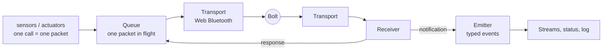

# Protocol

**Purpose.** This page explains how the app sends a command to a Bolt, how it
knows the Bolt got it, and how it hears what the Bolt reports by itself. It
ends with what a Bolt forgets, and how the app puts that back.

Two kinds of statements appear here:

- **The code does.** Checked against the files named under each heading.
- **Measured.** A run on a real Bolt, with its date. One run each unless it says otherwise.

## Contents

1. [[#1 The picture]]
2. [[#2 Connecting]]
3. [[#3 A packet]]
4. [[#4 Commands]]
5. [[#5 The queue and the ack]]
6. [[#6 Why every call is awaited]]
7. [[#7 Events]]
8. [[#8 Status and the log]]
9. [[#9 Takeover, reset, stop, fail]]
10. [[#10 What a Bolt forgets]]
11. [[#Open]]

## 1 The picture

Each connected Bolt is one `Bolt` object. It owns everything below.



- A **command** goes down: a method is called, the queue turns it into bytes, the transport writes them.
- A **response** comes back for every command. It is called the **ack**. The receiver hands it to the queue, and the waiting call continues.
- A **notification** is something the Bolt sends by itself, for example a collision. The receiver turns it into an event.

*Code: `packages/core/src/bolt.ts`*

## 2 Connecting

Bluetooth groups a device's data into **services**. A service has
**characteristics**, which are the places a program writes to and reads from.

| Name | UUID |
|---|---|
| Sphero service | `00010001-574f-4f20-5370-6865726f2121` |
| API v2 characteristic (all commands and answers) | `00010002-574f-4f20-5370-6865726f2121` |
| Initialize service | `00020001-574f-4f20-5370-6865726f2121` |
| Anti-DoS characteristic (the unlock) | `00020005-574f-4f20-5370-6865726f2121` |

**Finding the Bolt.** There are two ways.

- **Pair.** The browser shows a chooser with devices whose name starts with `SB-` and that offer the Sphero service. This needs a click.
- **Reconnect.** The browser lists the Bolts this page was allowed before. For each, the page waits for the Bolt's first advertisement, then connects. If none arrives, it starts waiting again: after 4 s, then 8, 16, and from then on every 30 s.

**Connecting.** In this order:

1. Connect to the Bolt's GATT server and look up the two characteristics.
2. Switch on notifications for the API v2 characteristic. Everything the Bolt sends arrives there.
3. Write the text `usetheforce...band` to the anti-DoS characteristic. The firmware refuses commands until it has this.
4. Only now does the transport report `connected`.

**Writing.** A packet is written in pieces of at most 20 bytes. The Bolt joins
the pieces by the packet's start and end bytes.

> Measured 2026-10-01: a 17 byte packet in one write passed, a 24 byte packet in one write failed.

*Code: `packages/web-ble/src/gatt.ts`, `transport.ts`, `discover.ts`; `apps/browser/src/bolts.ts`*

## 3 A packet

A command on the wire, byte by byte:

| Part | Bytes | Meaning |
|---|---|---|
| start | 1 | always `8D` |
| flags | 1 | see below |
| target | 0 or 1 | which processor, only if the flags say so |
| device | 1 | which part of the firmware, e.g. `16` driving |
| command | 1 | the command's number inside that device |
| sequence | 1 | a running number, 0 to 254 |
| data | any | the command's parameters |
| checksum | 1 | all bytes from flags to data added up, inverted, lowest 8 bits |
| end | 1 | always `D8` |

**Flags.** One bit each:

| Bit | Value | Meaning |
|---|---|---|
| 0 | `01` | this packet is a response |
| 1 | `02` | please answer this packet |
| 2 | `04` | answer only on error |
| 3 | `08` | this packet resets the inactivity timer |
| 4 | `10` | a target byte follows |
| 5 | `20` | a source byte follows |

The app sets bits 1 and 3 on every command, and bit 4 when the command names a target.

**Targets.** A Bolt has two processors.

| Target | Processor | Runs |
|---|---|---|
| `11` | Nordic | Bluetooth, power |
| `12` | ST | driving, sensors, matrix |

**Escaping.** The bytes `8D`, `AB` and `D8` have special meaning. If one of
them appears inside a packet, it is sent as two bytes: `AB 05` for `8D`,
`AB 23` for `AB`, `AB 50` for `D8`. The reader undoes this.

**Two examples.**

```
ping, sequence 1:                8D 0A 10 00 01 E4 D8
turn to heading 90, sequence 2:  8D 1A 12 16 07 02 00 00 5A 00 5A D8
```

In the second: flags `1A`, target `12` (ST), device `16` (driving), command
`07` (drive with heading), sequence `02`, data `00 00 5A 00` (speed 0,
heading 90 as two bytes, drive flags 0), checksum `5A`.

**A response** has the same layout, with bit 0 set in the flags and one more
byte after the sequence: the **error code**. The sequence number is the one
of the command it answers.

**A notification** carries sequence number 255 and no error code.

*Code: `packages/core/src/protocol/packet.ts`, `constants.ts`*

## 4 Commands

In the code a command is five things: a name (for the log), a device, a
command number, an optional target, and data bytes. Every method of
`bolt.sensors` and `bolt.actuators` sends exactly one packet.

The commands the app uses, by device:

**API processor `10`**

| Command | No. | Target |
|---|---|---|
| ping | `00` | none |

**Power `13`**

| Command | No. | Target |
|---|---|---|
| deep sleep | `00` | none |
| sleep | `01` | none |
| get battery voltage | `03` | Nordic |
| wake | `0D` | none |
| get battery state | `17` | Nordic |
| battery state notify on/off | `1B` | Nordic |
| get charger state | `1F` | Nordic |
| charger state notify on/off | `20` | Nordic |

**Driving `16`**, all to ST

| Command | No. |
|---|---|
| raw motors | `01` |
| reset yaw | `06` |
| drive with heading (roll) | `07` |
| stabilization | `0C` |

**Sensor `18`**, all to ST

| Command | No. |
|---|---|
| set streaming mask | `00` |
| set extended streaming mask | `0C` |
| gyro max notify on/off | `0F` |
| configure collision detection | `11` |
| reset locator | `13` |
| get infrared readings | `22` |
| calibrate to north | `25` |
| send infrared message | `2A` |
| listen for infrared messages | `2B` |
| get ambient light | `30` |

**User IO `1A`**

| Command | No. | Target |
|---|---|---|
| set all LEDs | `1C` | none |
| set matrix pixel | `2D` | ST |
| set matrix colour | `2F` | ST |
| save matrix frame | `30` | ST |
| save matrix animation | `31` | ST |
| list matrix frames | `34` | ST |
| delete matrix animations | `35` | ST |
| clear matrix | `38` | ST |
| set matrix rotation | `3A` | ST |
| scroll matrix text | `3B` | ST |
| draw matrix line | `3D` | ST |
| fill matrix | `3E` | ST |
| set matrix character | `42` | ST |
| play matrix animation | `43` | ST |

*Code: `packages/core/src/protocol/constants.ts`, `actuators/`, `sensors/sensors.ts`*

## 5 The queue and the ack

**The code does:**

- Every command goes through one queue per Bolt.
- Only **one packet is in flight**. The next one is written when the ack of the current one has arrived, or it has failed.
- A call to send a command returns a **promise**. It is settled by what happens to the packet.

| What happens | The call |
|---|---|
| ack with error code 0 | continues; for a read it gets the decoded value |
| ack with another error code | fails with `CommandError` and the code's name |
| no ack within 3 s | fails with `AckTimeoutError` |
| the Bluetooth write fails | fails with `WriteError` |
| not connected | fails at once with `NotConnectedError` |

- A failed write is **not retried**. (Code comment: in 289 sessions of September 2026 no retried write ever went through.)
- On a disconnect every waiting command fails with `NotConnectedError`.
- An ack does not wait for a motion to finish. After the ack of a turn, the code waits until the status says the ball is still.

**Error codes** the firmware can answer with:

| Code | Name | Code | Name |
|---|---|---|---|
| 0 | success | 6 | commandFailed |
| 1 | badDeviceId | 7 | badParameterValue |
| 2 | badCommandId | 8 | busy |
| 3 | notYetImplemented | 9 | badTargetId |
| 4 | commandIsRestricted | 10 | targetUnavailable |
| 5 | badDataLength | | |

**Measured 2026-10-03:**

> **How long an ack takes.** 100 pings per Bolt, one after the other.
>
> | Bolt | min | median | 90 % under | max |
> |---|---|---|---|---|
> | SB-9129 | 26 ms | 30 ms | 45 ms | 70 ms |
> | SB-11DF | 26 ms | 36 ms | 56 ms | 72 ms |

> **A command the Bolt does not know** (SB-11DF, sensor commands `3E` and `7F`): ack with error `badCommandId` after 37 and 51 ms.

> **A sleeping Bolt** (SB-11DF, two runs, about 24 s asleep each):
>
> | Sent while asleep | Processor | Result |
> |---|---|---|
> | ping | Nordic | ack, 29 ms |
> | get battery voltage | Nordic | ack, 42 and 68 ms |
> | matrix character, matrix clear | ST | no ack within 3 s |
> | stabilization | ST | no ack within 3 s |
> | roll (turn 90°), sent twice | ST | no ack within 3 s |
> | get infrared readings | ST | no ack within 3 s |
>
> The Bolt was dark and did nothing until it was woken.

*Code: `packages/core/src/protocol/queue.ts`, `errors.ts`, `payloads.ts`*

## 6 Why every call is awaited

`await` means: stop here until the promise is settled, then go on. Because a
command's promise is settled by its ack, `await` on a command means "go on
when the Bolt has answered".

**The code does:**

- A sequence is written as awaits, one under the other. These lines are from `reset`:

  ```ts
  await this.actuators.motor.stabilize(StabilizationIndex.none);
  await this.actuators.led.set(front, back);
  await this.communication.state('motor', 'resting');
  ```

  Each line runs after the Bolt has acked the line before.
- If a command fails, the error appears at the line that sent it, and the lines after it do not run.
- A call that is **not** awaited still goes through the queue in order. But the code after it runs before the ack, and a failure is no longer caught at that line. An uncaught failure ends the session, see [[#9 Takeover, reset, stop, fail]].

**Where the code does not wait, on purpose:**

- **Inside event listeners.** A listener cannot wait, so it starts the command and returns. Example: on "will sleep" the listener starts a wake.
- **Steering loops.** `rollIfIdle` sends a roll only when the queue is empty. So the newest command goes out and none pile up behind a slow ack.

With a median ack time of 30 to 36 ms (section 5), a Bolt takes about 30
commands per second, one after the other.

*Code: `packages/core/src/protocol/queue.ts`, `lifecycle/lifecycle.ts`, `actuators/motor.ts`*

## 7 Events

**Notifications the Bolt sends.** The receiver turns each into a named event.

| Event | Device, No. | Carries | Must be switched on by |
|---|---|---|---|
| `awake` | power `11` | nothing | nothing |
| `willsleep` | power `19` | nothing | nothing |
| `didsleep` | power `1A` | nothing | nothing |
| `battery` | power `1C` | state: unknown, ok, low, critical | battery state notify |
| `charger` | power `21` | state: unknown, not charging, charging, charged | charger state notify |
| `stream` | sensor `02` | one raw sample | the streaming masks |
| `gyromax` | sensor `10` | raw bytes | gyro max notify |
| `collision` | sensor `12` | impact per axis, speed, time | configure collision detection |
| `compass` | sensor `26` | angle of north | calibrate to north |
| `infrared` | sensor `2C` | the channel heard | listen for infrared messages |
| `scrolldone` | user IO `3C` | nothing | a scroll text command |
| `animationdone` | user IO `3F` | nothing | a play animation command |

A notification the receiver does not know is logged and emitted as `unknown`.

**The motion stream.** A `stream` notification is one sample of 52 bytes: 13
numbers for angles (pitch, roll, yaw), accelerometer, locator (position and
velocity) and gyro. The app asks for one every 50 ms. Each sample is parsed,
written into the status and emitted as `sensordata`. A sample of any other
length is dropped and logged.

**Events the app makes itself:** `log`, `change` (something visible changed),
`disconnected`, `fullstop`, `step` (a step began or ended), `help`.

**Listening.** There are two levels.

- `bolt.events.on(name, listener)` hears an event. `bolt.events.once(name, { timeoutMs })` waits for the next one and fails on timeout. Neither switches anything on in the Bolt.
- `bolt.sensors.<stream>.subscribe(listener, options)` **holds** a stream and returns a function that releases the hold.
  - The first hold sends the command that switches the notification on.
  - The last release sends the command that switches it off.
  - A hold with `null` as listener keeps the stream running without listening, for example so the status stays fresh.
  - Streams: `motion`, `collision`, `battery`, `charger`, `gyromax`, `infrared`, `awake`, `willsleep`, `didsleep`, `compass`.

**Values that are asked for, not sent.** These are commands with an answer in
the ack: battery voltage, battery state, charger state, infrared readings,
ambient light.

> Measured 2026-10-03, SB-11DF: after one "listen for infrared messages", three frames sent 200 ms apart gave one `infrared` event. The listen ends with the first message; it has to be sent again for the next.

*Code: `packages/core/src/protocol/receiver.ts`, `events/`, `sensors/sensors.ts`, `sensors/motion.ts`*

## 8 Status and the log

**Status.** `bolt.status` holds the newest known values: heading, angles,
position, speed, battery, charger, and more. Sensors and the receiver write
it; everything else reads it. A value that was never measured is `null`.

- `status.heading` is the heading the app last **commanded**. The measured yaw is in `status.angles.yaw` and counts the other way round.
- `status.isStill` says whether the ball neither moved nor turned in the last half second. It needs the motion stream to be held, and throws if there is no fresh sample.
- `status.ready` is true after a completed `reset`.

**Log.** Every Bolt emits `log` events:

| Type | When |
|---|---|
| `action` | a packet is about to be written: name, device, command, target, data |
| `event` | an ack arrived, or a notification, or a parsed sample |
| `info`, `warn` | what the code reports, e.g. `reset.in`, `reset.out`; a step of navigation, behavior or experiments logs `<name>.in` with its arguments as JSON and `<name>.out` with the milliseconds and its result, e.g. `experiments.hop.in [90]` (2026-10-10) |
| `fatal` | the error that ended the session |

**Session file.** The page writes every log entry of every Bolt as one line
into a file, `session-<start time>.jsonl`, in the browser's private storage
for this page.

- Lines are collected and written every 250 ms.
- `session.save()` returns when every line so far is in the file. The header buttons Disconnect, Reload, Reset, Sleep and Wake call it. Reload calls it before reloading.
- A reload by the dev server, or closing the tab, can lose the last 250 ms.
- When the page loads, the files of completed days are moved into month zips in the project folder `sessions/`.
- A value kept only in a page variable is not in the file and is gone after a reload.
- The header button "Clear log" empties the log on screen only. The file keeps everything.

*Code: `packages/core/src/status/status.ts`, `bolt.ts`, `apps/browser/src/session.ts`, `archive.ts`*

## 9 Takeover, reset, stop, fail

### Takeover: once per connection

Runs right after connecting. In this order:

1. Ping.
2. Start listening for "will sleep". While `status.keepAwake` is true, the app answers it with a wake.
3. Wake, and wait up to 300 ms for the `awake` event. A Bolt that was already awake sends none.
4. Hold the battery and charger notifications, for the status and the log.
5. Hold gyro max and collision (thresholds 50). Both flash a red `!` on the matrix.
6. Hold infrared.
7. Reset. If the `awake` event arrived, the Bolt was asleep: a hard reset is already running, and takeover waits for that one. If not, the Bolt was awake, as after a page reload: takeover runs a soft reset.
8. Read once: battery state, charger state, infrared readings, ambient light, battery voltage.

### Reset: one defined state

There are two. The **hard** reset runs after every `awake` event and from
the Reset buttons. The **soft** reset runs in takeover when the Bolt is
already awake. A call while a reset runs joins the running one; a hard one
asked for during a soft run follows it.

**What it leaves behind.** The Bolt knows only its own front. Yaw is 0,
the position is 0, 0, and the locator's +y points to the front. The status
holds the same values. Only a wake gives this state (see
[[#10 What a Bolt forgets]]), so a hard reset sleeps and wakes the Bolt.
This is the state after a hard reset. A soft reset keeps the frame of the
last wake, see below.

1. `status.ready` becomes false.
2. Motors off. Not "roll at speed 0 to the heading in the status": that heading is not the Bolt's yet.
3. Commented out since 2026-10-05: send every held stream setting again, then turn once around in place, which proved the shell turns. The turn shifts the ball a bit, and a Bolt placed on a start point has to keep its spot and direction.
4. Sleep, wait for `didsleep`, wake, wait for `awake`. Nothing in a reset moves the ball.
5. `status.heading` becomes 0, `status.position` becomes 0, 0.
6. Stabilization off.
7. Set the front and back LED to the Bolt's configured colours.
8. Log which matrix frames are stored on the Bolt.
9. Show the "resting" picture on the matrix.
10. Send every held stream setting again (streaming masks and notification switches).
11. `status.ready` becomes true.

> Measured 2026-10-03, with the turn of step 3, after a reset on each Bolt: SB-9129 yaw −0.4°, position 0, 0.2 cm; SB-11DF yaw 0.2°, position 0, 0 cm. A reset took 6.0 and 7.0 s, of which the sleep and wake took 2.1 and 2.2 s.
>
> With the turn as the last step instead (tried first), the yaw ended at −6.0° and −3.8°: the turn does not land exactly where it started.

**The soft reset.** Over a disconnect the Bolt keeps yaw and locator and
loses lights, matrix picture and streams ([[#10 What a Bolt forgets]]). So
after a page reload nothing has to be zeroed. The soft reset runs the steps
above without step 4 and step 5. Before step 11 it holds the motion stream
for one sample: the sample fills `status.position`, and `status.heading`
becomes the yaw counted clockwise. The log shows `reset.in soft`.

> Measured 2026-10-05, page reload with both Bolts awake: `reset.in soft` to `reset.out` took 1.4 s on each, no `awake` event, no sleep.
>
> Same day, hard reset, a 1 m roll, then a page reload. SB-9129: locator 97.0, 0.2 cm and yaw −93.7° before the reload (read 0.8 s after the roll ended), 96.3, 0.3 cm and −93.2° after it, `status.heading` 93. SB-11DF: −97.7, 0 cm and 88.4° before, −98.3, 0 cm and 88.7° after, `status.heading` 271.

**A wake nobody asked for.** When an `awake` event arrives and no hard
reset is running, the log gets the warning `awake: yaw and locator start
again at this pose`: the firmware has zeroed the frame where the Bolt
stands. The hard reset that follows changes nothing about that.

The app has no command path that resets the yaw. The button that did was removed on 2026-10-03.

### Fullstop

The STOP button and the space key call `fullstop` on every Bolt:

1. Every running step is told to abort.
2. The motors are switched off. Not "roll at speed 0": that would turn the ball to the commanded heading first.
3. An `S` blinks five times on the matrix.

### Fail

Any uncaught error, and any disconnect the app did not ask for, ends the
session: the error is logged as `fatal`, every connected Bolt aborts its
steps and switches its motors off, and `status.ready` becomes false. Nothing
is recovered. The page has to be reloaded.

*Code: `packages/core/src/lifecycle/lifecycle.ts`, `apps/browser/src/fatal.ts`*

## 10 What a Bolt forgets

> Measured 2026-10-03, SB-11DF, one run per column. The app's own takeover and reset were switched off for the test, so the table shows what the Bolt itself kept.

| The Bolt holds | Yaw reset | Disconnect, reconnect | Sleep, wake | Cradle button, wake |
|---|---|---|---|---|
| Locator position | kept | kept | zero | zero |
| Yaw | zero (that is the command) | kept | zero | zero ¹ |
| Stored matrix frames | kept | kept | gone | gone |
| Collision detection | kept | kept | off | off ² |
| Motion stream | kept | off | off | off |
| Infrared listen | kept | off | off | off ² |
| LED colours | kept | both pink | both pink | both pink |
| Matrix picture | kept | off | off | off |

¹ Not comparable: the Bolt was carried to the cradle.
² Tested while the Bolt sat in the cradle. Whether a tap or an infrared frame reaches it there as on the floor was not checked.

Other things seen in these runs:

- Sleep command to `didsleep` event: 2041 and 2058 ms.
- Wake command to `awake` event: 133 to 143 ms (five wakes).
- After the cradle button the Bolt is not asleep: it shows its name and battery level. Read right after reconnecting: ping was acked (66 ms) and the charger state was "charging", but "list matrix frames" and "set extended streaming mask" got no ack within 3 s. After a wake command the `awake` event came (143 ms) and the ST processor answered again. The cradle column of the table was read after that wake.
- Switching the motion stream on does not change the locator position (seen in the reconnect round).

**Where the locator gets its axes.**

> Measured 2026-10-03, SB-9129. Each leg: roll 23 to 30 cm with a plain roll command, physically always in the same direction, read which way the locator says it moved.
>
> | Leg | Commanded heading | Locator says | Difference |
> |---|---|---|---|
> | A, baseline | 180° | 180° | 0° |
> | B, after turning 90° and a yaw reset | 90° | 178° | 88° |
> | C, after a locator reset | 90° | 177° | 87° |
> | D, after sleep and wake, woken a quarter turn from the start facing | 90° | 90° | 0° |

- A wake lays the axes: +y is where the Bolt faces when it wakes, +x is 90° clockwise from that, seen from above.
- A yaw reset turns the heading frame and leaves the locator axes. After it, heading and locator disagree by the angle turned.
- A locator reset zeroes the position and leaves the axes.

**How the app answers this:**

| Forgotten | Put back by |
|---|---|
| LED colours, matrix picture | `reset`, steps 7 and 9 |
| Motion stream, notification switches | `reset`, step 10 |
| Stored matrix frames | the `Matrix` object forgets its list on `didsleep` and stores a picture again when it is next shown |
| Locator position, yaw, locator axes | not put back. `reset` makes a new defined state instead: it sleeps and wakes the Bolt, which zeroes all three, also when the Bolt had kept them. |
