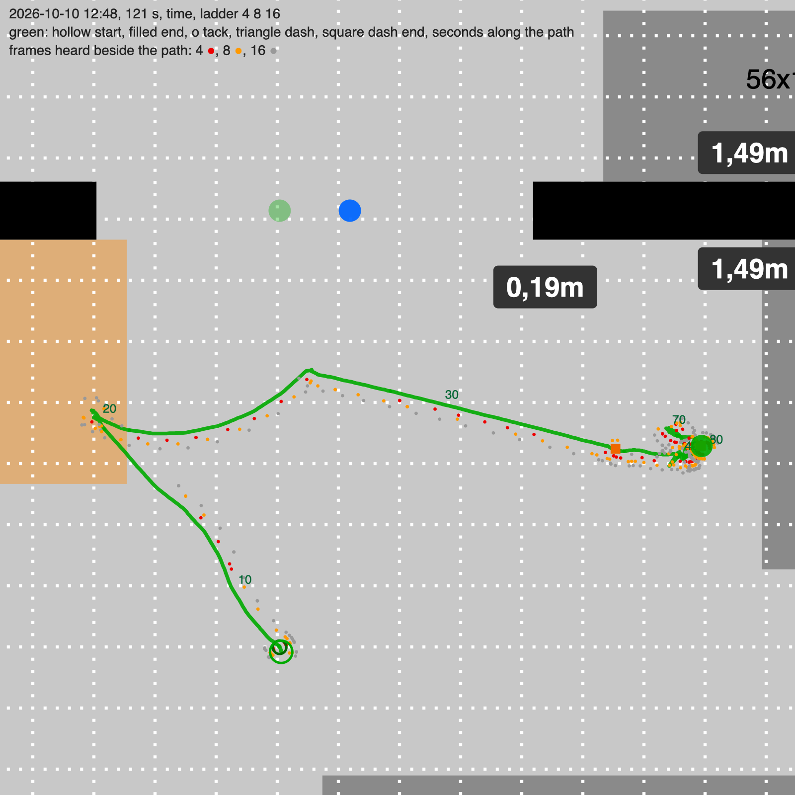
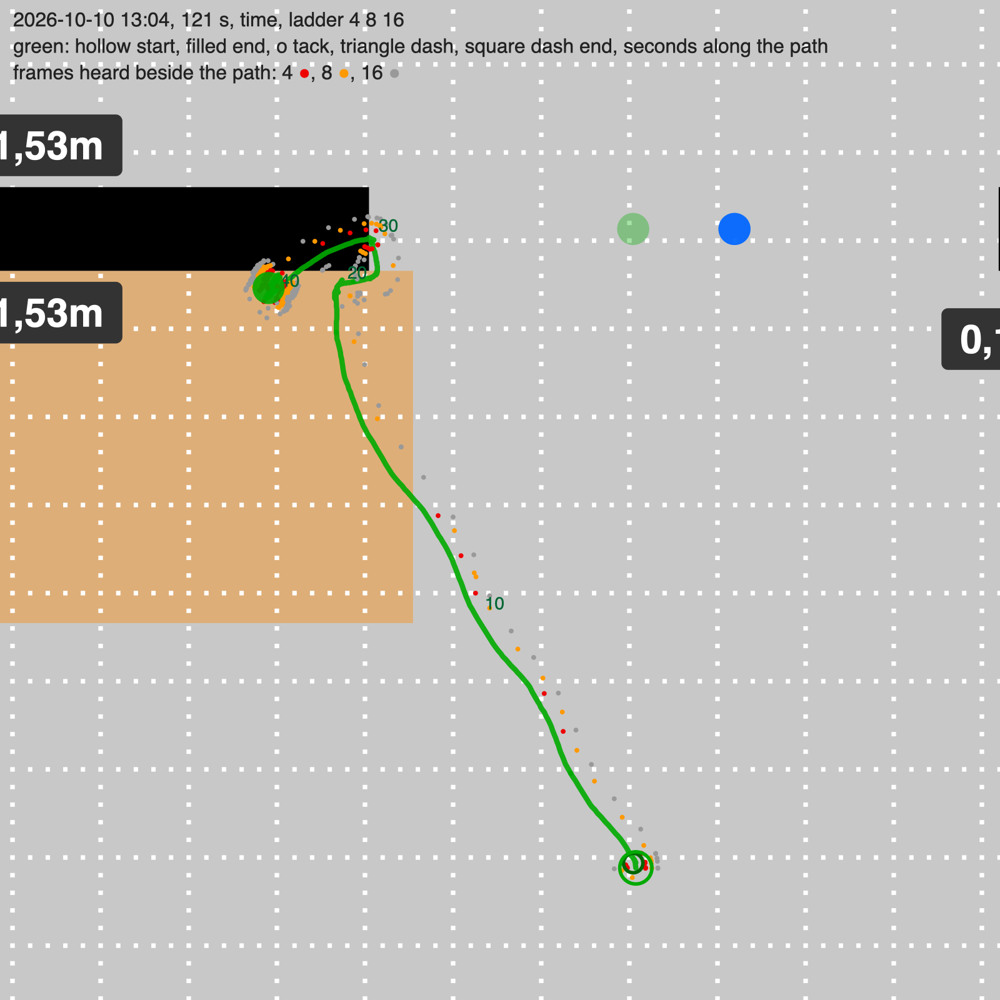
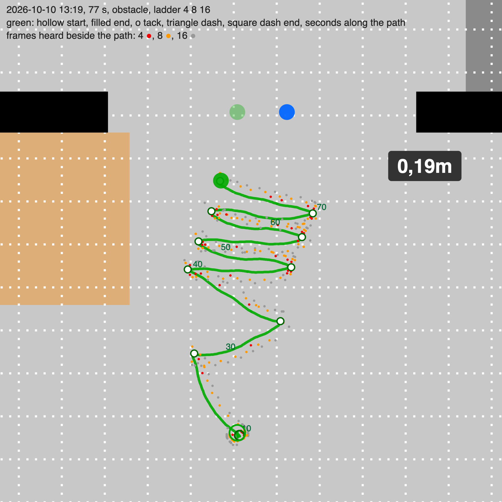
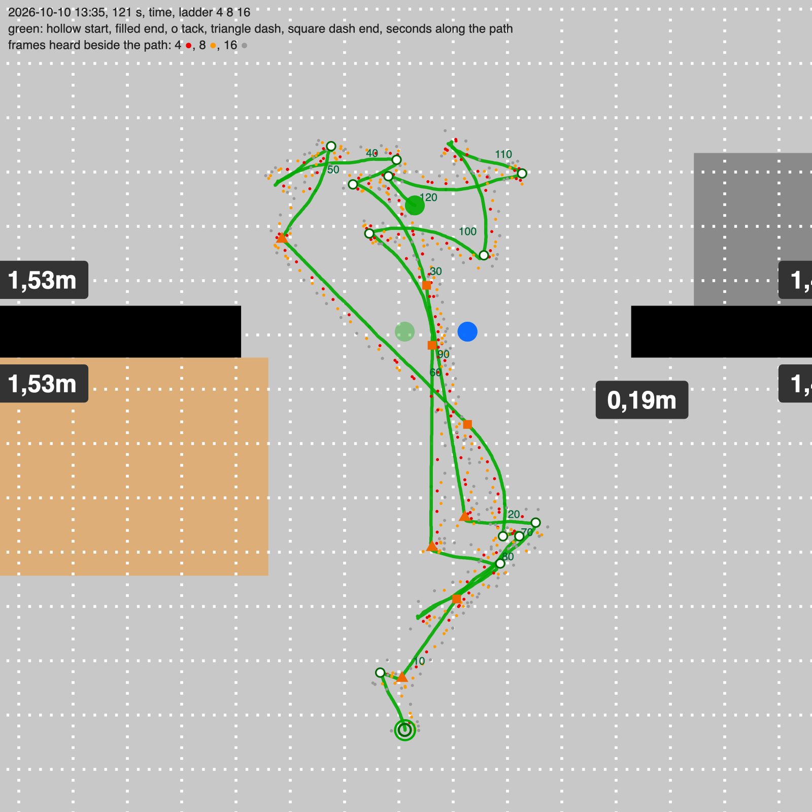
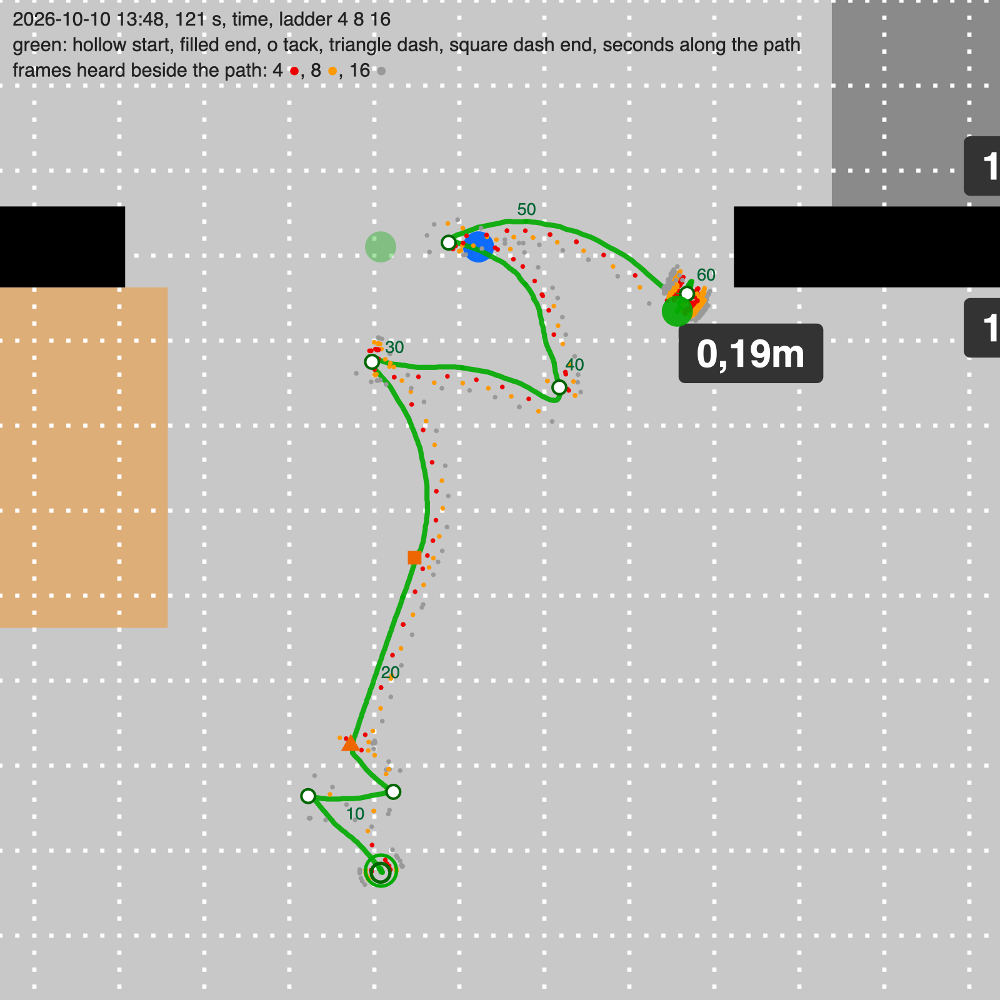
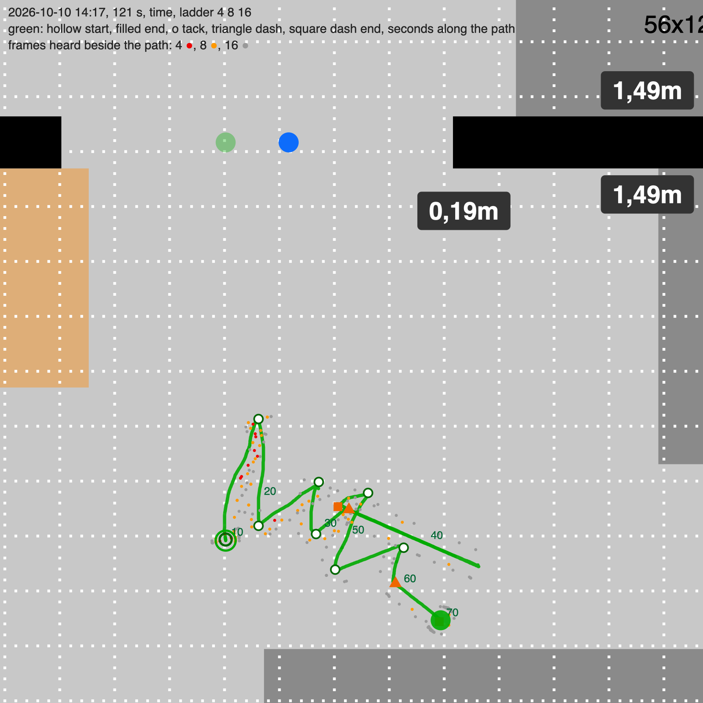
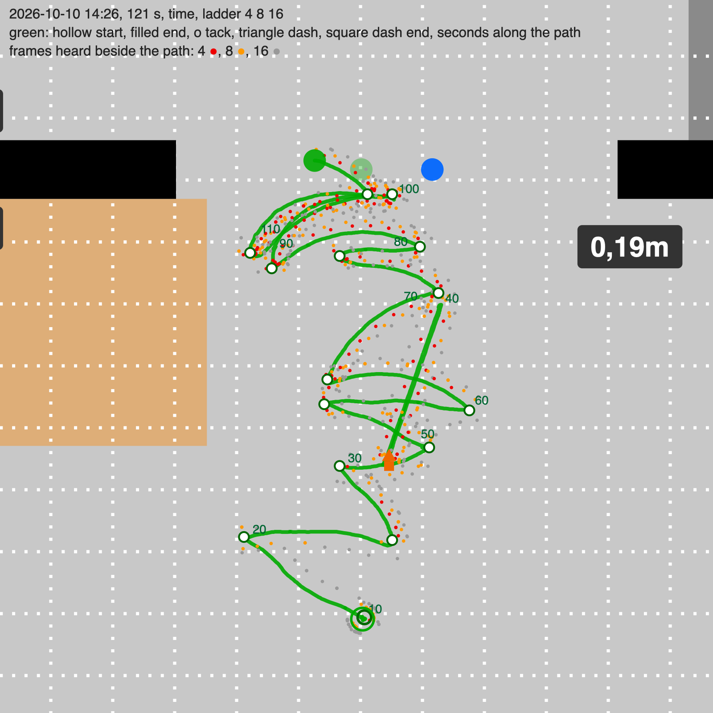
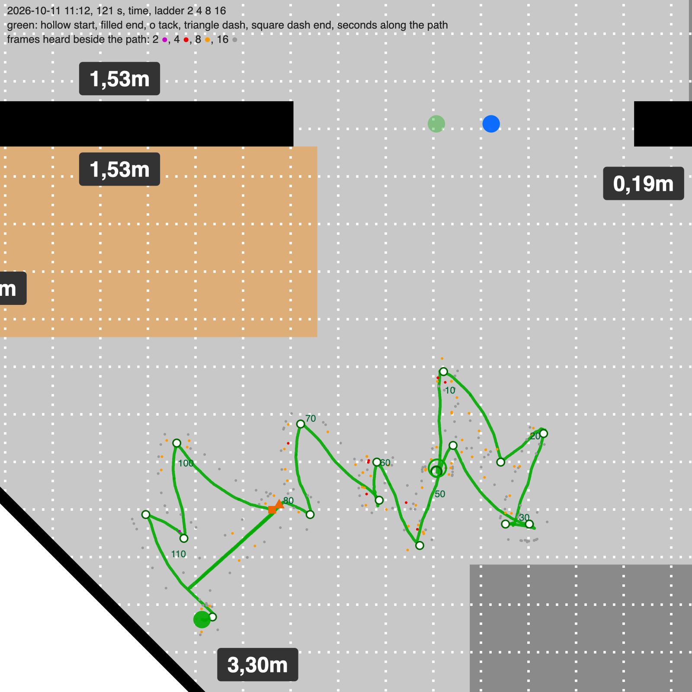

# seekEdge runs

**Setup, every run.** Blue on its mark in the opening, facing right along the partition, sends the ladder, one frame per 200 ms. Green reset on its mark, driven 1.5 m down the sheet, facing up toward blue, seeks. Budget 120 s. Both Bolts' collision detectors armed by the referee. Positions and bearings are the locators'; blue's place is its mark.

**The images.** The floor plan, green's path from its locator samples: hollow circle at the start, filled at the end, white dots at the tacks, orange triangle where a dash began and orange square where it ended, seconds along the path. Beside the path one dot per frame heard, by strength: 4 red, 8 orange, 16 grey, 2 purple. A gap in the dots is a silence. Made by `run_image.py` beside this note, run from the project root over a session file or a member of the sessions zip.

**The rule in all runs.** The weakest ladder level that arrives is heard with the sender within about 60° of the fore-aft axis, either end, and falls silent with the sender abeam. The seeker holds the sender 65° off its nose, on the edge of that: heard means turn a step away from the sender's side, silent while a stronger level came means a step toward it. Standing at first, the rule turns the ball until the verdict changes, which is the edge. Code: `packages/core/src/experiments/seek-edge.ts`, `seekToCollision` with method `edge`.

## Run 1: one edge held, a spiral

2026-10-10 12:48, commit 1338e37 with uncommitted changes, 121 s, ended on time, closest 54 cm.

The edge held on one side for the whole approach, so the path is a spiral. Carrier: the weakest level with 3 notifies in the last 6 rounds. A net left turn of 30° over 8 rounds ordered a half turn (sender at the other end). Distance from the turn rate; under 1.3 m speed 10, under 50 cm a dash. A second dash rule: the weakest level heard 6 rounds in a row meant near.

Edge found with blue 59° off the nose, the lobe edge to the degree. The spiral closed from 146 to 54 cm in 25 s. At the edge strength 4 is heard half the time by design, so it kept failing the 3-of-6 test and the carrier jumped to 8 or 16, which have no quiet side there; every round then said heard, the ball turned left until blue was behind, and the half-turn rule fired four times, wrongly each time. The near rule fired at 54 cm with blue at minus 91° and the dash went 65° to the right, away; it fired again at 136 cm. Speed 10 did not move the ball. Stuck at the right partition end from 35 s.

## Run 2: carrier is the weakest heard at all

2026-10-10 13:04, same code, carrier the weakest level heard in the last 6 rounds, no near rule, slow speed 20. 121 s, time, closest 82 cm.

Spiral from 146 to 82 cm in 25 s. At 82 to 91 cm strength 4 was silent six rounds in a row with blue inside the lobe, the carrier moved up to 8 then 16, heard every round, and the ball turned left until blue was behind. From 33 s stuck against the partition's left part, locator speed 0, no collision report at speed 20. The distance estimate never reached the dash: the servo turns 10° a round at most, 80° over the window, which reads as 67 cm at best.

## Run 3: tacking, legs of 40 cm

2026-10-10 13:19, code of commit 3193844 before its later changes, 77 s, ended by the referee as `obstacle`, closest 42 cm.

After each 40 cm by the locator the ball stands, turns 130° through the sender and holds the other edge. Carrier as in run 2, half turns as in run 1, no dash.

Edge at 52°. Nine legs in 53 s, 152 to 45 cm, every tack landing blue between 39° and 87° off the nose on the new side, every leg turning toward blue. Heard 50 % with blue in the edge zone, 69 % inside, 14 % outside. Carrier 4 throughout. At 74.5 s the ninth tack's hard turn fired green's collision detector, threshold 40, the floor; the referee counted a seeker report alone as an obstacle and ended the run at 44 cm. Near the sender the legs went sideways, 36 cm of swing for 17 cm closed.

## Run 4: legs end on silence, a dash from short legs

2026-10-10 13:35, commit 3193844, 121 s, time, closest 13 cm.

A leg ends at 40 cm or when the carrier has been silent two rounds in a row; a leg cut short carries the range, 2.6 times its length. Two short legs in a row: turn 65° toward the sender and roll the range plus a ball. Standing start ends on one round. Half turns on the summed legs. Seeker threshold 80, reports within 1.2 s of its own turn disregarded.

| Dash at | True distance | Range from the leg | Aim off | Passed at |
|---|---|---|---|---|
| 9 s | 129 cm | 26 cm | 24° | false alarm, start |
| 22 s | 68 cm | 71 cm | 10° | 13 cm |
| 53 s | 76 cm | 80 cm | 20° | 34 cm |
| 84 s | 80 cm | 69 cm | 10° | 14 cm |

Three ranges within 11 cm of the truth. The aim misses: 10° at 70 cm is 12 cm beside blue, a hit needs under 7. Three half turns, all wrong, each carried by one leg of minus 60 right after a dash, six heard rounds while turning away, which a sender behind gives and a sender deep inside the front lobe gives too. Edge declared at 15°, inside the lobe; the first two legs were cut by that, not by distance.

## Run 5: two-round start, no half turns, dash only from under 50 cm

2026-10-10 13:48, commit 4ae03a0, 121 s, time, closest 3 cm by the locator, no contact seen.

Run 4 with: the standing start ends on two rounds of the new verdict; no half turns; a short leg counts from 10 cm; the dash only from a short leg of 15 cm or less, aimed at the bisector of the two last leg ends.

Edge at 40°. Two legs cut short at 1.3 m with no full leg before them, dash from 121 cm with a range of 40 cm, aim 8° off, ended at 75 cm. Then three full legs of 41 to 45 cm at 37, 38 and 7 cm from blue: under 60 cm strength 4 was heard from most bearings, silences came singly, no leg was cut, the legs swung across blue's bow. A 1.6 g spike on green at 46 s, under its threshold of 80; blue at 20 reported nothing. From 54 s stuck at the right partition end.

## Run 6: tag by coincidence, short legs after a full leg, a missed dash backs up

2026-10-10 14:17, commit 86defb4, 121 s, time, closest 102 cm.

Referee: both collision reports within 300 ms are the tag, both detectors at 20, a report by one Bolt alone ends nothing. Seeker: a short leg counts only after a full leg; a dash that ends without a collision backs up its own length, faces the sender and tacks on. Hand test before the run: every bump reported by both Bolts, blue with magnitudes 20 to 34, green 42 to 67.

Edge declared at 22°, inside the lobe. Strength 4 heard in 9 of 40 rounds between 1.0 and 1.5 m, 5 of 18 with blue within 30° of the nose: silent was the majority everywhere, the rule said "slid out, turn right" round after round, the ball turned right without end, a circle, and blue swung from 22° through the nose to minus 157° in the first leg. Carrier 8 half the time, which has no quiet side at that distance, so every short leg was false and both dashes went away. From 59 s stuck at the furniture 1.8 m below the partition.

## Run 7: carrier by share, the weakest heard in 40 % of ten rounds

2026-10-10 14:26, commit 7be0577, 121 s, time, closest 15 cm.

One change: the carrier is the weakest level heard in at least 40 % of the last ten rounds, else the weakest heard at all.

Edge at 79°. Carrier 8 then 16 at 1.3 to 1.5 m, two full legs and a short one closing 147 to 101 cm, no circle. Dash at 34 s from 94 cm, aim 13° off, passed at about 18 cm, backed up as designed. Then eleven legs between 90 and 15 cm, most full length, swinging past blue and back: under 60 cm strength 4 was heard with blue abeam in 7 rounds of 8 and behind in 14 of 15, so no leg was cut, no range, no dash. Green reported 16 collisions on its own while tacking at threshold 20, blue none, no coincidence, no false end.

## Run 8: ladder 2, 4, 8, 16

2026-10-11 11:12, commit 6a6b3bc, 121 s, time, closest 106 cm.

One change: the ladder 2, 4, 8, 16, rounds of 0.85 s, so the carrier rule has a level to pick under 60 cm.

Edge declared at 6 s with blue 4° off the nose, dead ahead: the carrier rule had four rounds of history, not ten, fell back to the weakest heard at all, strength 4 at 10 %, and two noisy rounds passed for a change of verdict. The first leg swung blue behind to minus 116°; fourteen legs and one dash followed with blue behind or abeam, drifting from 106 to 241 cm. Strength 2 was heard once in the run, as expected beyond 70 cm; it was never tested where it matters.

## Across the runs

Strength 4 heard, rounds with green 1.0 to 1.5 m from blue, and strength 8 the same:

| Run | 1 | 2 | 3 | 4 | 5 | 6 | 7 | 8 |
|---|---|---|---|---|---|---|---|---|
| Strength 4 | 37 % | 50 % | 18 % | 42 % | 33 % | 28 % | 14 % | 10 % |
| Strength 8 | 68 % | 78 % | 100 % | 85 % | 58 % | 71 % | 60 % | 65 % |
| Ambient light at takeover, lux | 59 to 66 | 38 to 51 | 48 to 53 | 33 to 46 | 70 to 85 | 48 to 59 | 59 to 70 | 75 to 82 |

The share of strength 4 at the same distance varies from 10 to 50 % between runs, with no match to the ambient light or the batteries. Not explained.

Under 60 cm strength 4 has no quiet side: heard with blue abeam and behind in runs 5 and 7. Between 60 and 100 cm it has one, and the rule tacked to 45, 13, 3 and 15 cm on it. Beyond 1.2 m it is heard in one round of four or less and strength 8 carries, with a shallower quiet side.

The edge was declared with blue, by true bearing at that moment, at 59°, 37°, 52°, 15°, 40°, 22°, 79° and 4° off the nose in runs 1 to 8. Five of eight inside the lobe, under 45°. In runs 6 and 8 the first leg then swung blue behind; in runs 4 and 5 the first legs were cut short by it and a dash went off from 1.2 m.
